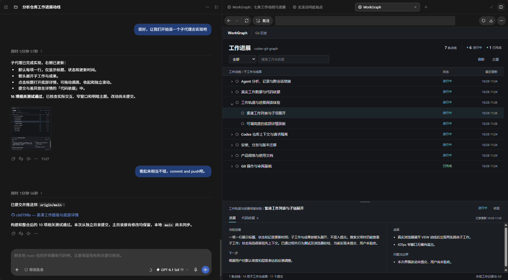
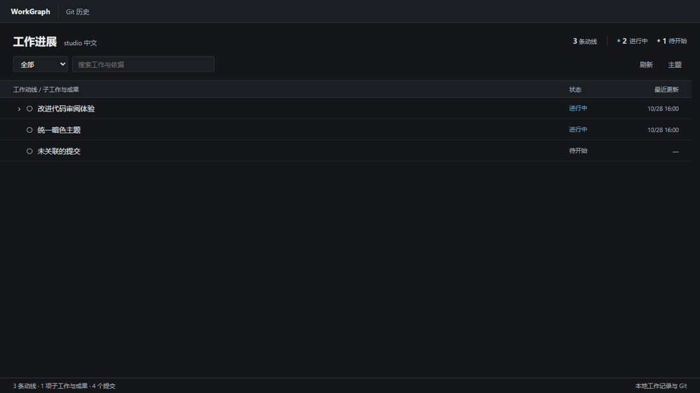
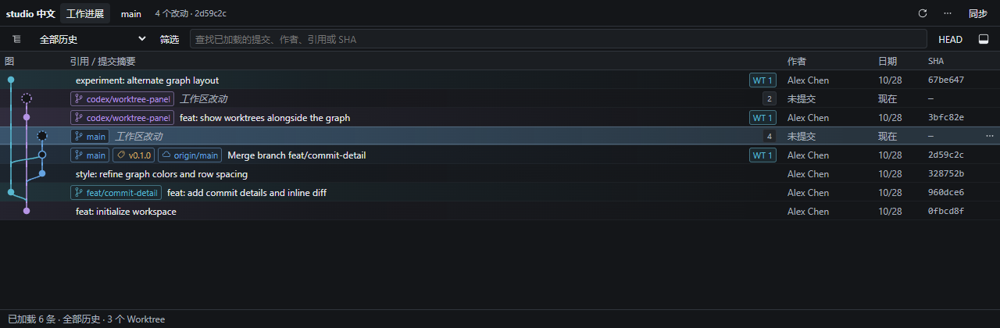

# WorkGraph

WorkGraph 是由 Agent 按用户要求维护的本地项目工作地图。通过 `workgraph` skill 整理目标、工作进展、成果、问题和下一步，并查看代码依据。可选 Codex 插件另外提供 Git 历史、差异审阅和仓库操作界面。



在聊天里让 Codex 整理仓库的工作记录，然后在右侧面板中查看。记录可以展开到子工作和成果，点击标题就能打开详情。

下面用示例仓库演示：展开工作，打开子项查看进展，再从「代码依据」进入关联提交，查看实际差异。



## 什么时候用

- 隔了一段时间回来继续开发，先看工作状态、下一步和还没解决的问题，再展开具体子工作。
- 想核对一项工作改了什么，打开「代码依据」查看关联提交和差异。未提交文件会单独列出。
- 需要检查分支和合并历史，切换到「Git 历史」查看提交图、标签和多个 Worktree，定位 HEAD，或比较两个提交。
- 准备提交代码时，逐文件检查差异、暂存并创建提交。面板也支持管理分支、标签、Stash 和远程仓库，以及创建新 Worktree。



上图使用示例仓库。提交图中的连线表示 Git 提交的父子关系。

本地历史读取不需要 GitHub 或 GitLab 登录；远程同步使用本机 Git 的现有认证。

<a id="开始使用"></a>

## 第一次使用

### 1. 启动面板

需要 Node.js 22+、npm 和 Git。当前实测环境为 Windows；其他平台尚未验证。

将最后一行的路径换成要查看的仓库，然后在终端运行：

```powershell
git clone https://github.com/Daoming-Chen/codex-work-graph.git workgraph
cd workgraph
npm install
npm run build
npm start -- --repo "D:\path\to\repository"
```

在 Codex 右侧浏览器中打开终端输出的完整链接。使用期间保持服务运行，结束后按 Ctrl+C 关闭。

也可以按[本地插件安装说明](docs/install-lifecycle.md)配置插件，通过聊天打开面板。目前提供源码构建和本地 marketplace 配置，桌面应用中的插件安装流程还需要验证。

### 2. 请 Agent 更新工作地图

安装统一的 `workgraph` skill 后，在目标仓库聊天中说「更新当前项目的工作地图」。Agent 结合仓库证据和当前聊天中确认的信息整理记录，CLI 自动判断首次建立、旧记录迁移或增量更新，无需选择 init 或 update。安装方法见[安装与打包](docs/install-lifecycle.md#独立-skill)。

分析结果经校验后保存到当前工作区的 `.workgraph/state.json`，旧 `.workgraph.json` 保留。已有 ID 和有效依据保持连续，失败时保留上一份记录。地图以目标、工作和成果组织，当前结构支持三层工作及成果，不新增独立的目标数据类型。

可选插件中的「更新工作地图」按钮也会自动选择流程，但它通过独立的本机 Codex CLI 分析仓库，使用现有登录和模型配置，消耗对应模型额度，无法读取当前聊天正文。Windows 默认查找 `codex.exe`，可通过 `WORKGRAPH_CODEX_PATH` 指定可执行文件绝对路径。

### 3. 刷新、展开，再查看代码依据

1. 在「工作进展」点击「刷新」，读取最新记录和 Git 数据。刷新只读取数据，不会让 Codex 重新分析仓库。
2. 点击行首箭头，展开子工作与成果。工作较多时，可以按状态筛选，或搜索工作与依据。
3. 点击工作标题，在底部「进展」中查看摘要、下一步、成果和问题。
4. 切换到「代码依据」，检查关联提交与实际差异；需要查看分支或更完整的历史时，点击顶部「Git 历史」。
5. 下次继续同一项工作时，打开详情的「续接说明」预览并复制，再交给当前聊天中的 Agent 核对。说明区分历史记录与当前元数据，不会自动启动分析或修改仓库。

仅在用户要求时更新工作地图。打开、刷新、查询状态及代码变化均不会触发分析，旧记录中的自动维护标记也不会启用后台更新。不提供自动提交、恢复点或自动验收。「已完成」不代表验证通过或用户验收。

工作视图默认读取当前工作区的 `.workgraph/state.json`（兼容旧 `.workgraph.json`）和 HEAD 最近 300 条提交，详情中只统计这次加载到的关联提交。

## 使用前了解

面板可以修改仓库和远程引用。执行前需核对目标仓库、Worktree、分支和操作摘要；删除、丢弃及部分历史重写操作需要明确确认。打开面板本身不代表授权写入。

- 不提供普通强制推送、交互式 Rebase 编辑器或 Worktree 删除。冲突内容需在外部编辑器修改。
- 查找只覆盖已加载的提交；文本预览和 diff 最多显示 256 KiB。
- SSH、WSL 和跨主机访问尚未验证。回环链接指向服务所在机器，不要公开服务或创建公网隧道。
- MCP Apps 原生入口和随聊天切换仓库的行为取决于宿主，不能保证在所有 Codex 版本中可用。

## 首次分析配置实验

2026-11-04 在一个包含 35 个受跟踪文件、17 个提交的设计文档仓库上测试了本地开发版首次分析流程。进入串行复测的三个主要候选方案如下，均为单代理：

| 候选方案 | 调用耗时中位数 | 质量分／100 | 单次 API 标价估算／USD | 选择建议 |
| --- | ---: | ---: | ---: | --- |
| gpt-6.1-sol＋medium | 175 秒 | 98.1 | $0.36 | **优先建议**：本样本的事实覆盖较稳定 |
| gpt-6.1-sol＋low | 108 秒 | 91.4 | $0.20 | 速度、成本优先时考虑，需复核重要遗漏 |
| gpt-6-astra＋low | 144 秒 | 91.0 | $1.25 | 对照候选，本样本未显示费用对应的质量优势 |

以上为每配置两次串行复测的中位数，质量分由两位独立代理盲评后汇总；费用按请求的 Priority 档位和回报用量估算，不代表实际账单或订阅额度消耗。这是单项目、小样本的选择依据，不是通用模型排行或当前发布版的性能承诺。

在 gpt-6.1-sol＋medium 下，2／3 个读代理加 1 个汇总分别耗时 255／241 秒，质量均约 97 分，费用约 $0.77／$0.89；本项目优先单代理。并行样本采用独立 CLI 进程。

[完整实验结果、评分方法与限制](docs/benchmarks/2026-11-04-initialization.md) · [逐次结果 CSV](docs/benchmarks/2026-11-04-initialization.csv)

## 文档与贡献

- [安装与打包](docs/install-lifecycle.md)
- [使用指南](docs/usage.md)
- [WorkGraph 工作记录与数据边界](docs/work-graph.md)
- [共用工作模型与兼容契约](docs/work-model-contract.md)（开发接口，本地记录格式保持兼容）
- [故障排查](docs/troubleshooting.md)
- [贡献指南](CONTRIBUTING.md) · [架构与安全边界](docs/current-implementation.md)
- [本地版与云端版设计及实施方案](docs/local-cloud-design.md)（规划：共用模型、运行边界与 GitHub 试点）
- [项目开发视图产品概念](docs/project-development-concept.md)（早期探索，后续边界以本地版与云端版设计为准）

## 许可证

WorkGraph 采用 [Apache License 2.0](LICENSE)。第三方依赖与素材遵循各自的许可证，相关声明见 [THIRD-PARTY-NOTICES.md](THIRD-PARTY-NOTICES.md)。

